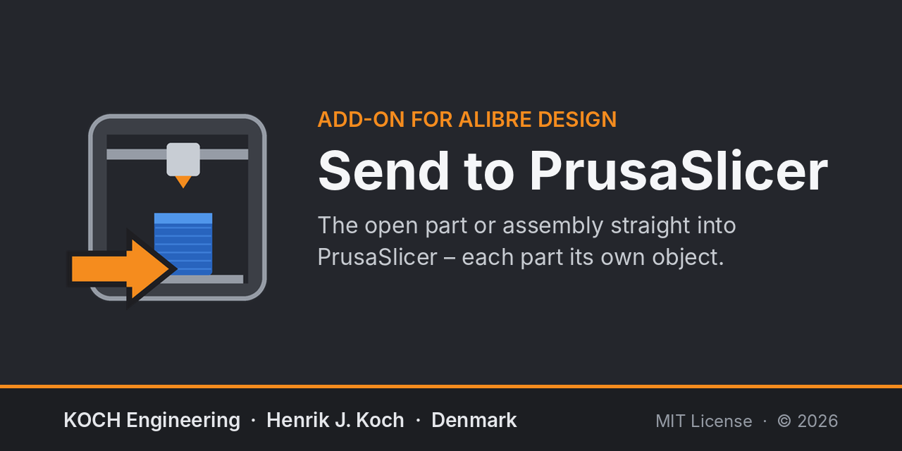

# KOCH Send to Slicer – for Alibre Design

**Developed by [KOCH Engineering](https://www.linkedin.com/in/henrikjkoch/) (Henrik J. Koch, Denmark). Built with Claude (Anthropic).**

💬 **Questions, ideas or bugs?** Join the discussion in the [Alibre forum](https://www.alibre.com/forum/index.php?threads/three-free-add-ons-for-alibre-design-%E2%80%93-export-parts-send-to-prusaslicer-3dconnexion-keys.27260/) or open a GitHub issue.

One click in Alibre Design sends the open **part**, or **every part of the open assembly as separate objects**, straight to **PrusaSlicer**, **Bambu Studio** or **OrcaSlicer**. You no longer need to export STL files one by one and drag them in.

## Features

- **Three slicers:** PrusaSlicer, Bambu Studio and OrcaSlicer. Bambu Studio is built on PrusaSlicer and OrcaSlicer on Bambu Studio, so they work the same way.
- **STL or STEP**, your choice. PrusaSlicer opens both; STEP gives PrusaSlicer the exact geometry.
- **Part:** exports the part and opens it in PrusaSlicer.
- **Assembly:** every part becomes its own object in PrusaSlicer, ready to place on the bed or to give each part its own extruder or filament (e.g. on a Prusa XL or INDX).
- **One object per instance:** 4 identical bolts in the assembly give 4 objects (can be turned off).
- **Same rules as Export Parts:** sub-assemblies are included, suppressed parts are skipped, and hidden parts can be skipped too.
- **Mesh quality** follows your own STL export settings in Alibre.
- **Arranged on the bed:** when more than one object is sent, the add-on presses **A** (Arrange) in PrusaSlicer once loading has finished, so the parts don't lie on top of each other (can be turned off).
- **Uses the open PrusaSlicer:** the parts are added to the PrusaSlicer window you already have open (`--single-instance`), or PrusaSlicer is started.
- **Finds your slicers automatically**, including unzipped/portable copies (from running programs, Windows' list of programs that have run, "Open with" associations and typical folders). Alpha, beta, RC and nightly builds are marked *pre-release*. Without a choice, the newest stable PrusaSlicer is used, then Bambu Studio, then OrcaSlicer; your choice is remembered.

📖 **[User guide](docs/USER-GUIDE.md)**: choosing your slicer, alpha/beta versions, all settings and troubleshooting.

## Install

1. Download `KOCH-Send-to-PrusaSlicer-Setup-x.y.z.zip` from **[Releases](../../releases)** and unzip it.
2. Close Alibre Design and run the `.exe`. The installer is not code-signed; if Windows SmartScreen warns you, click **More info → Run anyway**.
3. Start Alibre Design. You'll find **Add-on → Slicer → Send to slicer**.

**Tip:** turn on the slicer's *only one instance* preference (PrusaSlicer: **Preferences → "Allow just a single PrusaSlicer instance"**). New parts then go into the window you already have open. PrusaSlicer is also started with `--single-instance`.

Uninstall from **Windows Settings → Apps → KOCH Send to Slicer (Alibre add-on)**.

## Use

| Menu | What it does |
|---|---|
| **Send to slicer** | Exports the active part or assembly to STL or STEP and opens it in your slicer |
| **Settings…** | PrusaSlicer location, copies, sub-assemblies, suppressed/hidden parts, mesh quality and export folder |
| **Reload add-on** | Loads a newly installed version without restarting Alibre |

### Settings

| Setting | Default | Meaning |
|---|---|---|
| PrusaSlicer | newest stable version | All installed versions are listed with their version number, e.g. 2.9.7 and 3.0.0-alpha5. Without a choice, the newest **stable** version is used; alpha, beta and RC builds only if nothing else is installed. For a PrusaSlicer that is only unzipped (e.g. an alpha), use **Browse…** once; it then stays in the list |
| Arrange the parts on the bed | on | With more than one object, **A** (Arrange) is pressed in PrusaSlicer when loading is done. If PrusaSlicer asks a question first (e.g. multi-part object), it waits until you've answered |
| One object per instance | on | 4 identical bolts give 4 objects. Off means one object per unique part |
| Include parts in sub-assemblies | on | Parts inside sub-assemblies are sent too |
| Skip suppressed parts | on | Suppressed parts and sub-assemblies are left out |
| Skip hidden parts | off | Hidden parts are left out |
| File format | STL | **STL** or **STEP** (AP214, AP242 or AP203). With STEP, PrusaSlicer builds the mesh itself, which gives smooth curves |
| Use my STL export settings | on | STL only: Alibre's STL quality settings are used; off means Alibre's default |
| Save the files in | Temporary folder | Or a `Print\<model>` folder next to the model, so the files are kept |

Each send clears the STL/STEP files from the previous send of the same model, so you never get old parts.

## Good to know

- Parts are exported in **their own coordinates**, not where they sit in the assembly. PrusaSlicer places them on the bed, so you can arrange them for printing.
- Drawings cannot be sent; open the part or assembly instead.
- The log is in `%LOCALAPPDATA%\Alibre AddOns\KochPrusaSlicer\addon.log`, and the settings are in `%APPDATA%\Koch Engineering\PrusaSlicer\settings.ini`.

## Build from source

```
Source/Loader   KochPrusaSlicer.dll       – the small DLL Alibre loads (references AlibreX / AlibreAddOn)
Source/Core     KochPrusaSlicer.Core.dll  – all logic and UI (.NET Framework 4.8, VB.NET, Alibre used late-bound)
installer/      NSIS script
```

With the .NET SDK installed, close Alibre and double-click `install.cmd`. Later updates can be installed while Alibre is open; then click **Reload add-on**.

## Related

- [Export Parts](https://github.com/KOCH-Engineering/alibre-export-parts) exports STL/STEP for every part of an assembly to a folder.
- [3Dconnexion Keys](https://github.com/KOCH-Engineering/alibre-3dconnexion-keys) puts Alibre commands on your SpaceMouse Enterprise and Keyboard Pro keys.

## License and trademarks

MIT, © 2026 KOCH Engineering. See [LICENSE](LICENSE).

Alibre and Alibre Design are trademarks of Alibre, LLC. PrusaSlicer is a trademark of Prusa Research a.s. LinkedIn is a trademark of LinkedIn Corporation. This project is not affiliated with or endorsed by these companies.

## Support

This project is free and open source. If it saves you time and you'd like to say thanks, you can [buy me a coffee ☕](https://buymeacoffee.com/henrikkoch) – thank you!
